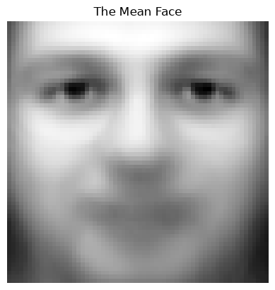
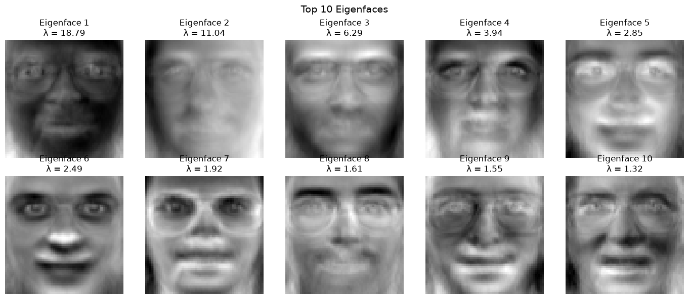
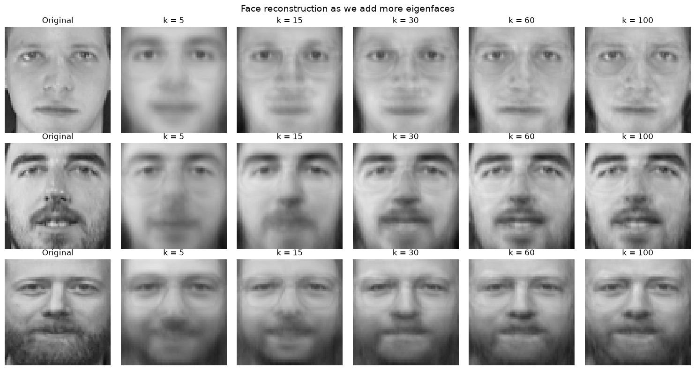
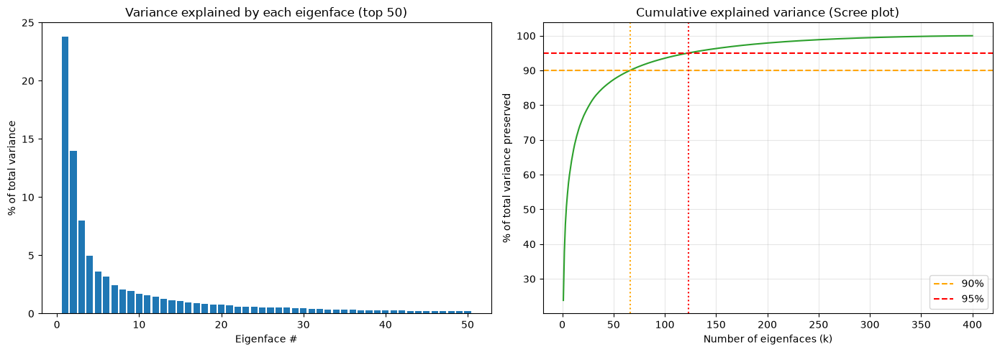
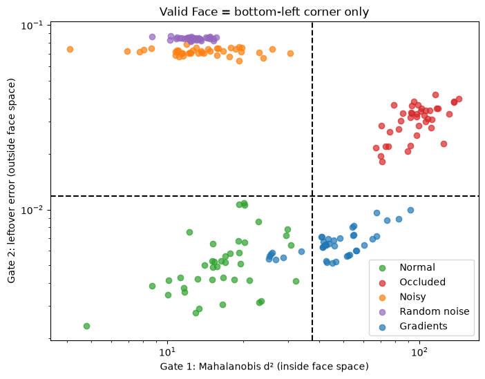
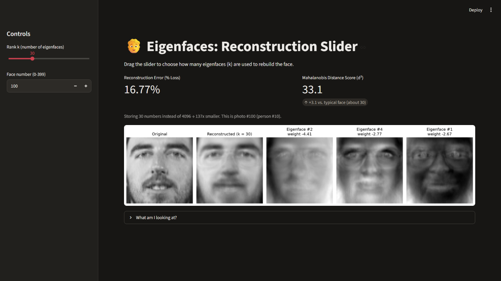

**Live demo:** https://eigenfaces-project-eigenfaces-slider.streamlit.app/

# Eigenfaces & Spectral Geometry
From-scratch dimensionality reduction and anomaly detection on faces, using pure
NumPy linear algebra (no `sklearn.decomposition`, no `cv2`).

Foundational papers: Turk & Pentland (1991), *Eigenfaces for Recognition*, and
Shlens (2014), *A Tutorial on Principal Component Analysis*.

## What this project does
1. Treats each 64 x 64 face as a vector in R^4096 and computes the mean face.
2. Finds the main directions of face variation ("eigenfaces") with the
   **snapshot trick**: an eigenproblem on a 400 x 400 matrix instead of 4096 x 4096.
3. Compresses faces to k numbers and rebuilds them, measuring the error.
4. Detects non-faces with two gates: Mahalanobis distance (inside face space)
   and reconstruction error (distance from face space).
5. Logs experiments into SQLite and analyzes them with 8 SQL queries.
6. Provides a Streamlit app with a live rank slider.

Dataset: Olivetti / AT&T faces, 400 images (40 people x 10 photos), 64 x 64 grayscale.
`scikit-learn` is used **only** to download the dataset.

## Key results

### The snapshot trick
| | Size | Memory |
|---|---|---|
| Direct covariance | 4096 x 4096 | about 134 MB |
| Snapshot matrix | 400 x 400 | about 1.28 MB (99% less) |

Only 399 eigenvalues are meaningful (the last is about 1e-10, because centering
removes one degree of freedom).

### Reconstruction quality vs. rank k
| k | MSE per pixel | Frobenius error | Compression |
|---|---|---|---|
| 5 | 0.008789 | 120.00 | 819x |
| 30 | 0.003509 | 75.82 | 137x |
| 100 | 0.001246 | 45.18 | 41x |
| 150 | 0.000709 | 34.08 | 27x |
| 399 | about 0 | 0.0002 | none |

The measured error matches theory: MSE_k equals the sum of the discarded
eigenvalues divided by 4096.

### Optimal rank (scree plot)
| Variance preserved | k needed | Compression |
|---|---|---|
| 90% | **66** | 62x |
| 95% | **123** | 33x |
| 99% | **260** | 16x |

The first 5 eigenfaces alone carry 54.4% of the variance, and the first 30 carry 81.8%.
**Recommended rank: k = 66 for a good quality/size trade-off, k = 123 when high
fidelity matters.**

### Anomaly detection (k = 20)
Data split per person: 8 photos train, 1 validation (used to set thresholds),
1 test (final exam).

- **Gate 1:** Mahalanobis d^2 <= 37.57 (chi-square 99th percentile, 20 degrees of freedom)
- **Gate 2:** reconstruction error <= 0.0119 (validation mean + 3 standard deviations)

| Input type | Flagged by Gate 1 | Flagged by Gate 2 | Final "Anomaly" |
|---|---|---|---|
| Normal test faces (should be 0%) | 0% | 0% | **0%** |
| Occluded (black bar over eyes) | 100% | 100% | **100%** |
| Noisy faces (strong static) | 0% | 100% | **100%** |
| Random noise images | 0% | 100% | **100%** |
| Smooth gradients | 82% | 0% | **82%** |

Overall: **153 / 160 anomalies caught, 40 / 40 test faces accepted, 96.5% accuracy.**

Main finding: Gate 1 alone let static through (it scored *more* normal than real
faces), because static has a small, ordinary-looking projection onto face space.
Adding the reconstruction-error gate fixed this.

### SQL telemetry (`eigen_telemetry.db`, `queries.sql`)
Two tables (`image_metadata`: 400 rows, `rank_evaluations`: 4,000 rows) and 8 queries
using `GROUP BY`, `HAVING`, `CASE WHEN`, `RANK()`, `ROW_NUMBER()` and `LAG()`.
- Six people (subjects 3, 12, 13, 14, 20, 26) are the hardest to rebuild, needing
  k = 150 to get under 10% average loss.
- Diminishing returns: each extra component gains about 2.5 percentage points of
  quality early on (k = 5 to 10), but only about 0.14 by k = 60 to 80.
- 15 faces have an unusually high Mahalanobis d^2 at k = 20.

### Streamlit app

## How to run
    pip install numpy matplotlib seaborn scikit-learn streamlit jupyter
    jupyter notebook eigenfaces_mathematics.ipynb      # full analysis
    streamlit run app.py                               # interactive slider

The SQL queries use window functions, which need SQLite 3.25 or newer
(included with any recent Python).

## Files
| File | What it is |
|---|---|
| `eigenfaces_mathematics.ipynb` | Main notebook: data, SVD from scratch, plots, anomaly detection, SQL |
| `paper_notes.md` | Summary of the two papers |
| `math_derivations.md` | Centering, snapshot trick, Mahalanobis derivations |
| `queries.sql` | 8 analytical SQL queries |
| `eigen_telemetry.db` | SQLite database of reconstruction metrics |
| `app.py` | Streamlit reconstruction slider |

## Limitations (honest notes)
- **Smooth gradients can pass as faces.** They resemble the "lighting" eigenfaces and
  fit inside face space, so 7 of 160 anomalies slipped through, all gradients.
- **Thresholds are a trade-off.** Lowering them catches more anomalies but risks
  rejecting real faces. Gate 1 flagged 5% of validation faces, more than the 1%
  that a perfect bell curve predicts, so real face codes have heavier tails.
- **Small test set.** 40 test faces: 40/40 accepted does not mean zero false alarms.
- **Database metrics are in-sample.** The SQL analysis rebuilds the same 400 faces
  used to fit the model, so it measures compression quality, not generalization.
- **Synthetic non-faces only.** Noise and gradients were used. Real photos of
  objects (e.g. CIFAR-10) were not tested.
- **Controlled data.** Olivetti faces are centered, frontal and evenly framed.
  PCA is linear, so changes in pose or lighting are not handled well.